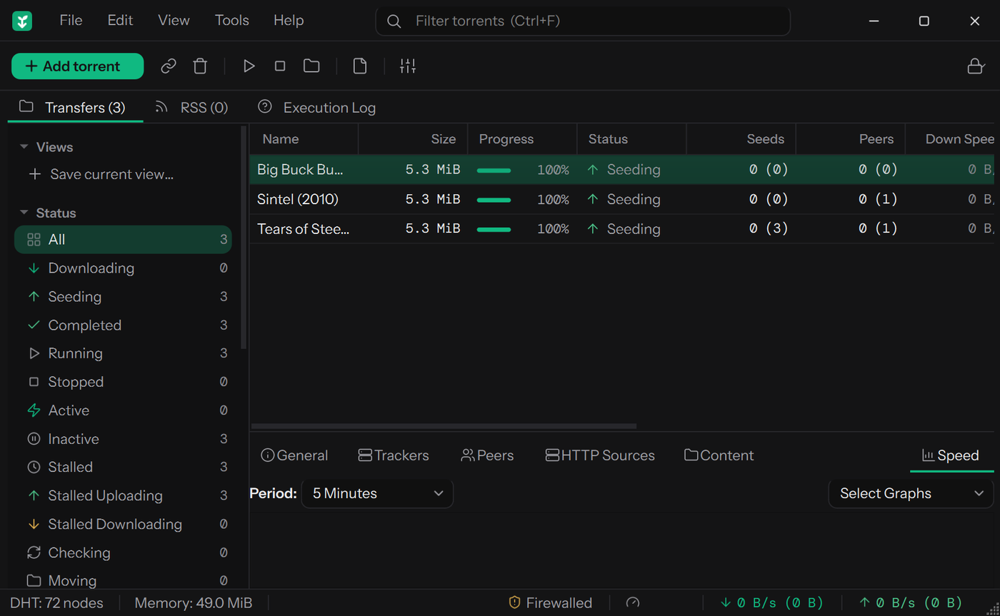
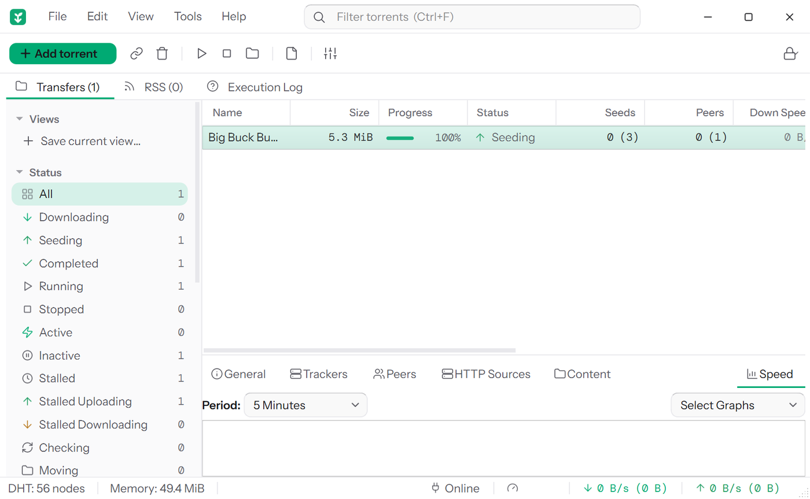
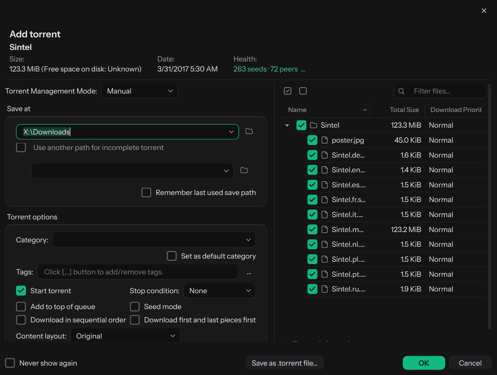
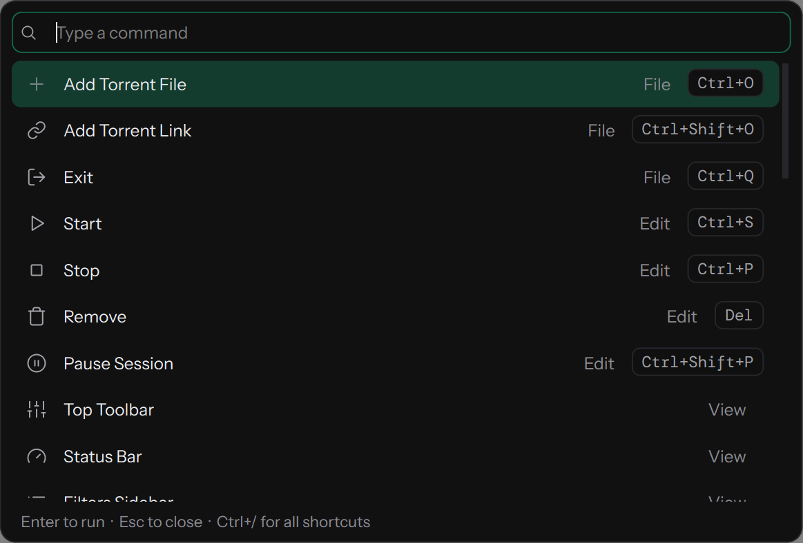
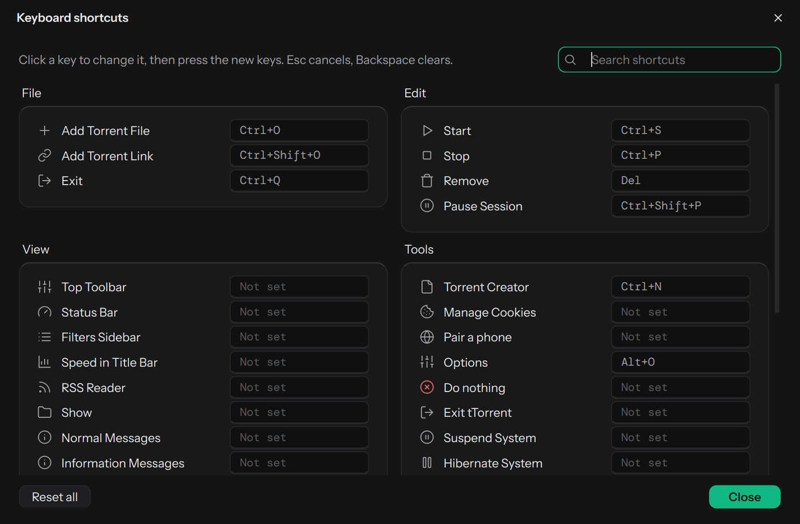
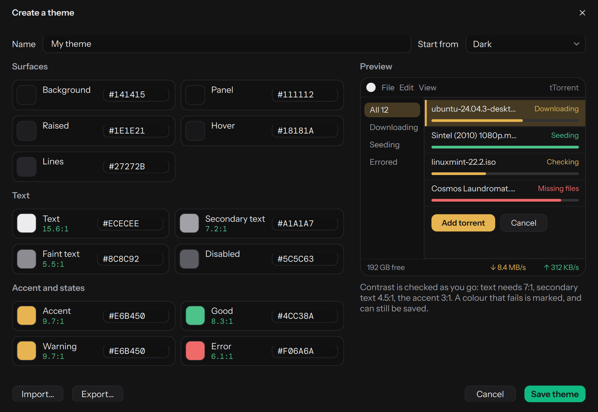
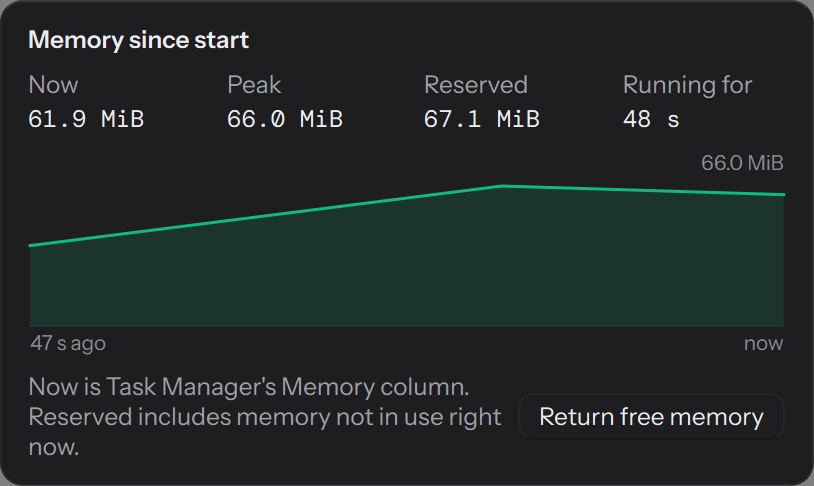

<p align="center">
  
</p>

<h1 align="center">tTorrent</h1>

<p align="center">A fast, modern torrent client for Windows with a polished look and nothing in the way.</p>

It stays light with hundreds of torrents, and it handles what usually needs scripts or add-ons: disk space, webhooks, unpacking, backups and AI agents.



## Install

Download the latest version from [Releases](https://github.com/t21dev/tTorrent/releases/latest). It needs 64-bit Windows 10 or 11.

- **Installer** (`tTorrent-<version>-windows-x64-setup.exe`): installs in `C:\Program Files\tTorrent`, so Windows asks for admin rights once. You choose:
  - a desktop shortcut and a Start menu shortcut;
  - starting tTorrent when Windows starts;
  - opening magnet links and .torrent files with tTorrent;
  - a Windows Firewall rule and long file paths (over 260 characters).

  Versions up to 0.6.4 installed in `%LOCALAPPDATA%\Programs\tTorrent`. The installer moves that copy to Program Files and keeps your torrents and settings, starting with Windows, and opening magnet links and .torrent files. If you pinned the old copy to the taskbar, pin it again.
- **Portable** (`tTorrent-<version>-windows-x64.zip`): unzip anywhere and run `ttorrent.exe`.

The installer isn't code-signed yet, so Windows SmartScreen may say "Windows protected your PC". Click **More info › Run anyway**, and compare the file with the release's `sha256-<version>.txt` if you want to be sure.

Uninstalling keeps your torrents and settings (in `%APPDATA%\tTorrent` and `%LOCALAPPDATA%\tTorrent`). tTorrent never reads or changes qBittorrent's settings, except when you use **Settings › Backup and import › Import from qBittorrent**, which copies them.

## What's in it

**Everyday**
- **Command palette** (Ctrl+K): run any command by typing part of its name.
- **Keyboard shortcuts** (Ctrl+/): every shortcut in one window, and you can change any of them.
- **Saved views:** save the current filters, search and sort as a sidebar entry.
- **Health in the Add dialog:** seeds and peers from the trackers before you add a torrent. Private trackers are never asked: they count every request on your passkey.
- **Notification cards** with "Open folder" and "Show" when a torrent finishes or fails.
- **Rename categories and tags**, with subcategories and every torrent following.
- **Relocate:** files you moved or renamed outside the app? Point the torrent at them and it rechecks instead of downloading again.

**Looking after itself**
- **Low disk space guard:** stops downloads before a drive fills, and starts them again when there's room.
- **Backup and restore:** settings and the torrent list with each torrent's progress. Back up now, restore later, or back up every day automatically.
- **Memory card:** click Memory in the status bar to see memory now, the peak and a graph since start. tTorrent hands freed memory back to Windows when it's in the background.
- **Update check** from GitHub releases. Nothing is downloaded without you.

**Connecting**
- **Webhooks:** a URL is called with JSON when a torrent is added, finishes or fails.
- **Unpack when finished:** .zip, .rar and .7z files are extracted next to the archive.
- **Pair a phone:** a QR code opens the Web UI on your phone.
- **AI agents (MCP):** a built-in [Model Context Protocol](https://modelcontextprotocol.io) server lets Claude Code, Codex or Cursor see and manage your torrents.
  - Off by default, and reachable from this computer only.
  - One key, which can look only, or look and manage.
  - Agents can't delete downloaded files.
- **Import from qBittorrent:** torrents with their progress, categories, tags, RSS and settings in one step, with no recheck.

**Look**
- **Themes:** 17 of them, plus Follow system and your own from the theme editor:
  - light: Light, Paper, Latte, Solarized, Blossom;
  - dark: Dark, Ink, Charcoal, Nord, Dracula, Mocha, Tokyo, Rosé Pine, Gruvbox, Vampire, Aurora, Ember.
- **Accent:** any colour, with its lightness adjusted to 3:1 contrast on the theme.
- **Density:** Dense, Compact or Standard. **Interface size:** 80 to 150 %.
- **Toolbar:** slim or regular, choose which buttons show, and filter from the title bar.
- **Progress bars:** Line, Bar, or Filled with the percentage inside.

## Screenshots

| | |
|---|---|
|  |  |
| **Light theme** | **Add dialog** with health from the trackers |
|  |  |
| **Command palette** (Ctrl+K) | **Keyboard shortcuts** (Ctrl+/) |
|  |  |
| **Theme editor** with a live preview | **Memory card** from the status bar |

Screenshots use open movies from the Blender Foundation as sample torrents.

## Compared with qBittorrent

tTorrent began as a fork of qBittorrent 5.3 and takes in each qBittorrent release; it is now built on 5.3.1. Here is how the two compare today.

### Performance

Measured on 18 November 2026 on one PC (AMD Ryzen 9 9900X, 62 GB, Windows 11 Pro), using a copy of a real profile with about 735 torrents.

- **Setup:** each app ran alone, minimized, with downloads limited to 1 KiB/s and the Web UI off.
- **Memory:** Task Manager's Memory column (private working set). "Private bytes" is the memory reserved for the app.
- **Method:** [ttorrent/VERIFY.md › Benchmarks](ttorrent/VERIFY.md). The script is `ttorrent/scripts/bench.ps1`.

**30 minutes running** (one run each, sampled every 15 s, a tTorrent development build between 0.1.0 and 0.2.0):

| | qBittorrent 5.3.0 | tTorrent |
|---|---|---|
| Memory, average | 141 MB | **129 MB** |
| Memory, last 10 minutes | 127 MB | **117 MB** |
| Private bytes at 30 min | 198 MB | **187 MB** |
| CPU, average | 0.17 % | **0.12 %** |
| Read from disk | 77 MB | 72 MB |

**First 2 minutes after start** (three starts each, sampled every second, tTorrent 0.3.0):

| | qBittorrent 5.3.0 | tTorrent |
|---|---|---|
| Memory at 2 min | 162–190 MB | 173–177 MB |
| Peak | 270–286 MB | 263–272 MB |
| Private bytes at 2 min | 196–199 MB | **179–184 MB** |
| Read from disk | 31 MB | **23 MB** |

**In short:**
- Settled, tTorrent uses about 10 MB less memory, about 11 MB less reserved memory and about 30 % less CPU.
- At start-up it reads about a quarter less from disk.
- Peak memory at start-up is about the same.
- These are single-machine measurements, and single runs vary by a few MB.

### Added

Everything under "What's in it" above is new in tTorrent, except the Web UI and the core torrent features it inherits from qBittorrent.

### Left out or changed

| Feature | In tTorrent |
|---|---|
| qBittorrent's update checker | Replaced by tTorrent's own update check |
| Donate menu item | Removed |
| Search engine and search plugins | Left out |
| Peer host names | Left out |
| Embedded tracker | Left out |
| I2P | Left out |
| Email on completion | Replaced by webhooks |
| Alternative Web UI | Left out |
| Legal notice on first start | Removed |
| Execution log | Keeps 2,000 messages instead of 20,000 |
| Known peers per torrent | 1,500 by default instead of 3,000 (Settings › Advanced, up to 3,000) |

These features are switched off in one place (`src/gui/dose/dosetrim.cpp`), not deleted, so tTorrent stays easy to merge with new qBittorrent releases.

## Private trackers

Trackers see tTorrent as qBittorrent: the peer ID and user agent are qBittorrent's (5.3.1 today), so a tracker that allows qBittorrent accepts tTorrent too. Only people see tTorrent's own version.

## Troubleshooting

- **Trackers say "Not contacted yet" and nothing downloads or uploads.** tTorrent couldn't open its port. Look in **View › Log › Show** for "Failed to listen". Another program may be using the same port, for example qBittorrent with a profile you imported. Pick another port in **Settings › Connection**, or close the other program. Versions before 0.6.3 also had this problem after **Restart tTorrent**: quit tTorrent and start it again.
- **The same private torrent in two clients.** Many private trackers refuse a torrent that is active in two clients at once on your account. Pause it in one of them.

## Build (Windows)

```powershell
powershell -ExecutionPolicy Bypass -File ttorrent\scripts\setup.ps1   # Qt, vcpkg, libtorrent
powershell -ExecutionPolicy Bypass -File ttorrent\scripts\build.ps1   # build\Release\ttorrent.exe
```

Needs Visual Studio Build Tools 2022, CMake and Python (for `aqtinstall`). How we work and check changes: [ttorrent/AGENTS.md](ttorrent/AGENTS.md), [DESIGN.md](ttorrent/DESIGN.md), [VERIFY.md](ttorrent/VERIFY.md).

## Licence and credits

tTorrent began as a fork of [qBittorrent](https://www.qbittorrent.org/) and is being rebuilt from there to be leaner, faster and cleaner. Thanks to the qBittorrent project and its contributors, whose work it started from, and to [libtorrent](https://www.libtorrent.org/).

tTorrent is GPL: source files are GPLv2 or later, binaries GPLv3 or later (see [COPYING](COPYING) and [COPYING.GPLv3](COPYING.GPLv3)). Third-party parts:
- the custom title bar uses [QWindowKit](https://github.com/stdware/qwindowkit) (Apache-2.0);
- QR codes use [QR Code generator](https://www.nayuki.io/page/qr-code-generator-library) by Project Nayuki (MIT);
- the fonts are Instrument Sans and DM Mono (OFL);
- the Nord theme's colours come from [Nord](https://www.nordtheme.com/) (MIT).
