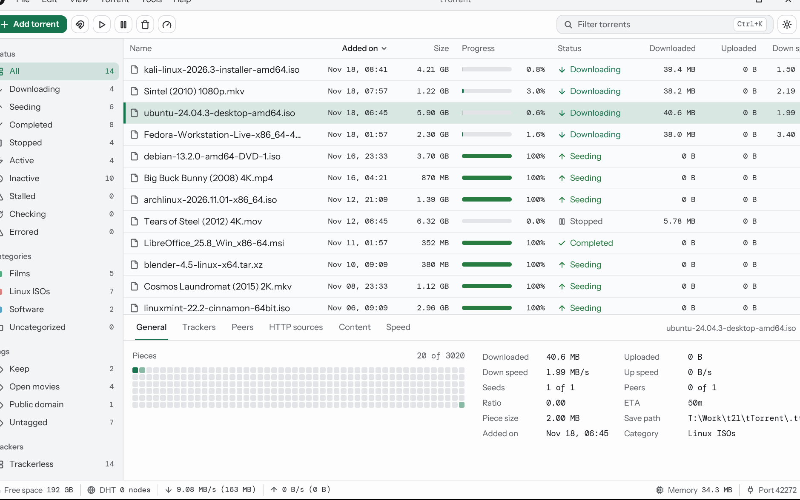
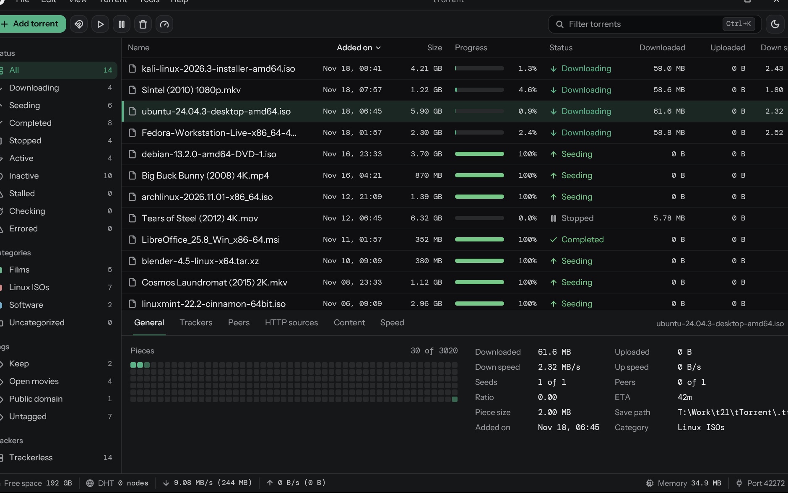
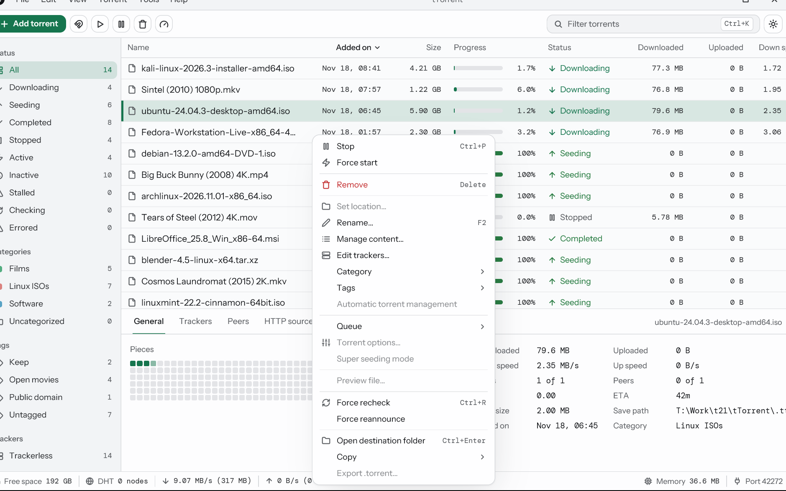
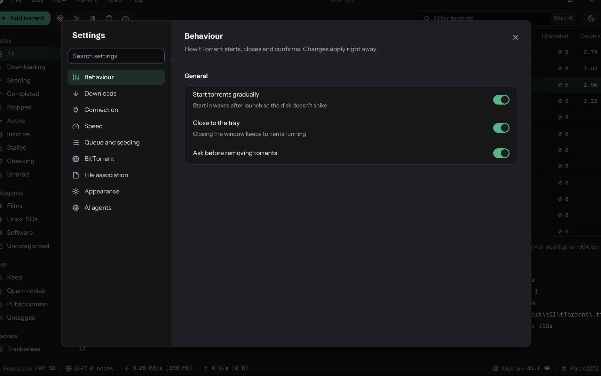
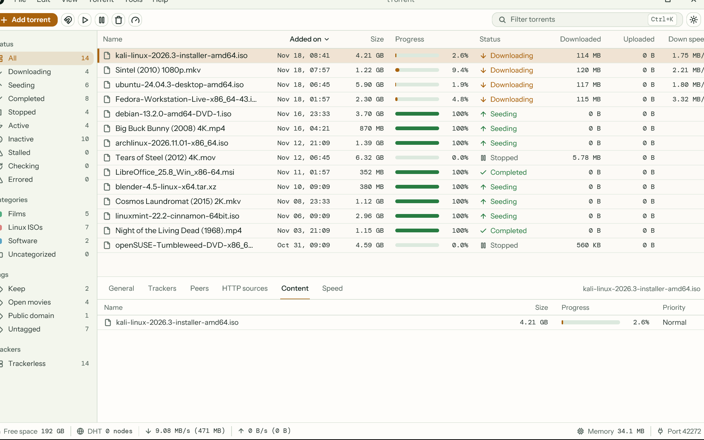
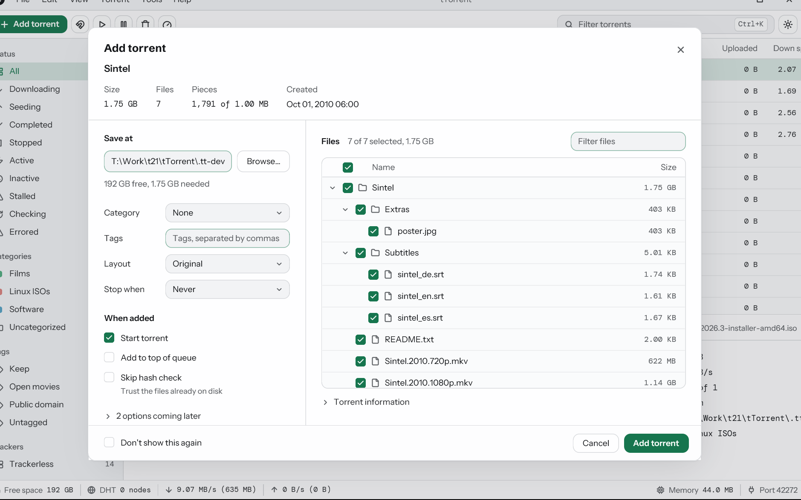
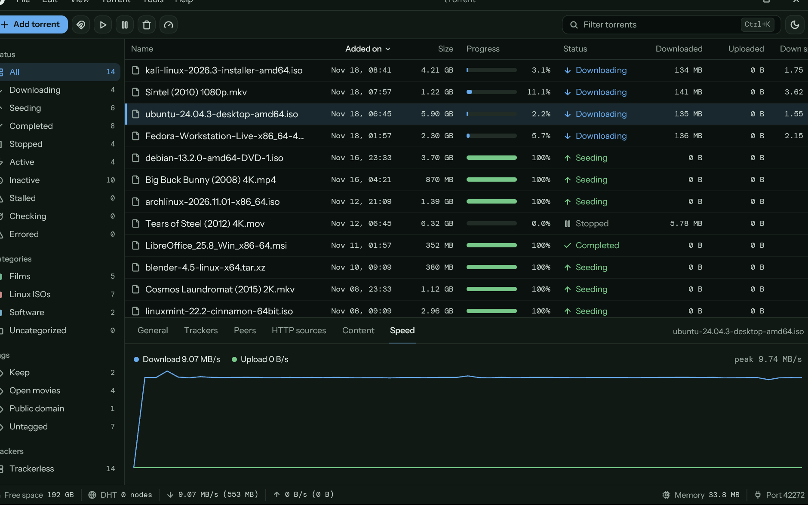

<div align="center">

# tTorrent

**A full-featured torrent client that stays fast, light and calm, however many torrents you keep.**

<sub>A desktop torrent client written in Rust: the librqbit engine runs on its own, and a GPUI window opens only when you need it.</sub>

A **[t21 dev](https://github.com/t21dev)** project, by **[TriptoAfsin](https://github.com/TriptoAfsin)**, from the team behind [Turbo Reader](https://github.com/t21dev/turbo-reader) and [Kitab Reader](https://github.com/t21dev/kitab).

</div>

> **Status: early alpha, Windows.** The engine, the window, the tray and the MCP server run, and the screenshots below are the real app. Many v1 features are still missing, and one memory budget is broken today (see [Measured so far](#measured-so-far)). Progress is tracked in [PLAN.md](PLAN.md) › Phases.



<table>
<tr>
<td></td>
<td></td>
</tr>
<tr>
<td align="center"><sub>Dark mode</sub></td>
<td align="center"><sub>The torrent menu keeps qBittorrent's order and shortcuts</sub></td>
</tr>
<tr>
<td></td>
<td></td>
</tr>
<tr>
<td align="center"><sub>Settings</sub></td>
<td align="center"><sub>Tinted surfaces, amber accent, compact density, Content tab</sub></td>
</tr>
<tr>
<td colspan="2"></td>
</tr>
<tr>
<td colspan="2" align="center"><sub>Double-click a .torrent or click a magnet link: the Add torrent dialog (Blender's open movie Sintel)</sub></td>
</tr>
<tr>
<td colspan="2"></td>
</tr>
<tr>
<td colspan="2" align="center"><sub>Speed tab, blue accent</sub></td>
</tr>
</table>

<sub>How these were made: `tt-bench demo` creates 14 synthetic torrents named after open content (Linux ISOs, Blender open movies, public-domain films), with zero-filled sparse files. A local seeder serves them on loopback, the real engine and window run against it, and the window captures its own pixels. Sizes, speeds and progress are what the app measured during that run. No torrent site, tracker or DHT was contacted.</sub>

## Why

Desktop torrent clients that do everything tend to get heavy: memory climbs with uptime, the disk thrashes at every start, and the interface hasn't moved on in years. tTorrent keeps the complete feature set and a layout you already know, and adds memory that stays flat, hard caps you can see and set, a calm modern interface, and a built-in way for AI agents to help.

Targets ([PLAN.md](PLAN.md); where they stand today is under [Measured so far](#measured-so-far)):

- Under 30 MB while it runs in the tray with hundreds of torrents.
- About 100 MB with the window open, never above 120 MB.
- The same on day 7 as on day 1.
- No disk spike at startup: no rechecks unless a file changed, torrents start in waves, the list shows in under 300 ms.
- No feature cuts: every limit keeps the usual default and stays a setting.

## Measured so far

Owner's desktop (Ryzen 9 9900X, RTX 5070), 18 November 2026, release build with tTorrent's librqbit fork, two runs each (not yet the 15-run medians the [performance guideline](docs/perf/README.md) asks for). Memory is sampled once every torrent has started; Task Manager memory is the private working set. Method and raw numbers: [docs/perf/log.md](docs/perf/log.md).

| 735 torrents, synthetic library (3.5 TB, all complete) | Budget | Measured | |
|---|---|---|---|
| Window open, engine + window | 100 MB target, 120 MB limit | 117 MB | over target, under limit |
| Tray only (engine) | 30 MB target, 50 MB limit | 88 MB | ⚠️ over the limit |
| Launch to list on screen | 300 ms target, 500 ms limit | 424–427 ms | over target |
| Engine file reads, launch until every torrent started | no recheck unless a file changed | 28 MB (6.4 GB before the fork) | |
| Engine writes in the same minute | none set yet | 220–274 MB | ⚠️ `session.json` rewritten per torrent, likely |
| Engine CPU, idle in the tray | none set yet | 1.5 % of one core (0.06 % in Task Manager) | |

Two librqbit changes are in tTorrent's fork and proposed upstream:

- **Per-block state only while downloading** ([ikatson/rqbit#757](https://github.com/ikatson/rqbit/pull/757)): librqbit kept a bit for every 16 KiB block of every torrent, finished or not. About 27 MB less here.
- **Trust saved progress when file sizes match** ([ikatson/rqbit#758](https://github.com/ikatson/rqbit/pull/758)): librqbit read samples of every file at every start. Startup reads drop from 6.4 GB to 28 MB; a missing or truncated file still triggers a check.

What's left is mostly per-torrent cost while running (about 33 KB each), the piece hashes of finished torrents (20 bytes per piece), the `session.json` writes and the once-a-second tick ([PLAN.md](PLAN.md) › librqbit change list).

**Against qBittorrent, like for like** (`tt-bench qb`: qBittorrent 5.3.0 in an isolated profile on the same 735 torrents with files capped at 64 MB, both fresh starts, single runs, memory with every torrent started):

| | tTorrent (fork) | qBittorrent 5.3.0 |
|---|---|---|
| Launch to window | 413 ms (list painted) | 165 ms |
| Memory, window open / tray only | 80 / 52 MB | 32 / 23 MB |
| File reads / writes, first minute | 2.9 / 254 MB | 2.9 / 0.1 MB |
| CPU time, first minute; idle | 1.7 s; 1.6 % of a core | 0.4 s; 0.1 % |

On a fresh start qBittorrent is still ahead on memory, writes and CPU; startup reads are now level. qBittorrent's growth with uptime (about 1.3 GB on the owner's machine after days) is not in a fresh-start test; a 24-hour run is planned.

## Build and run

Windows 10 or 11, Rust 1.95 or newer (`rust-toolchain.toml` pins stable).

```
cargo build --release
target\release\ttorrent.exe                 # engine + tray; opens the window
target\release\ttorrent.exe some.torrent    # opens it in the Add torrent dialog (of the running one, if any)
target\release\ttorrent.exe --minimized     # tray only
target\release\ttorrent.exe --import-qbittorrent   # import your qBittorrent library, no recheck
target\release\ttorrent.exe --register      # make tTorrent the default for .torrent and magnet: (docs/associations.md)
```

`ttorrent.exe` is the engine and tray. It starts `ttorrent-ui.exe`, the window, when you open it, and the window exits when you close it, so the GPU is only used while you look. Data lives in `%APPDATA%\tTorrent`; `--data-dir` picks another folder.

### AI agents

Turn on Settings › AI agents › Allow AI agents to connect, then, for Claude Code:

```
claude mcp add ttorrent -- "<folder>\ttorrent.exe" --mcp --scope read
```

`--scope manage` lets the agent pause, resume, categorise, tag, add and remove torrents. Agents can never delete files. More in [docs/mcp.md](docs/mcp.md).

### Tests and measurements

```
cargo test --workspace
cargo clippy --all-targets -- -D warnings
cargo deny check licenses
cargo build --release
target\release\tt-bench demo                       # screenshots in docs/screenshots, memory table
target\release\tt-bench library 735 .tt-dev\lib735 # synthetic library with resume data
target\release\tt-bench startup .tt-dev\lib735     # launch to list, memory, startup disk reads, idle CPU
target\release\tt-bench open-shot .tt-dev\demo\engine .tt-dev\demo\Sintel.torrent out.png   # open like a double-click
```

## Crates

| Crate | What it is |
|---|---|
| `tt-engine` | `ttorrent.exe`: librqbit session, SQLite store, queue, startup waves, tray, local API |
| `tt-ui` | `ttorrent-ui.exe`: the GPUI window |
| `tt-ipc` | The typed API between them: requests, events, the 38 columns, formats, settings |
| `tt-theme` | Dose tokens: OKLCH colours, accents with contrast rules, density, scale, motion |
| `tt-mcp` | The MCP server behind `ttorrent --mcp` |
| `tt-import` | qBittorrent `BT_backup` and categories reader |
| `tt-platform` | Windows: data folders, memory counters, free space, tray, file association |
| `tt-bench` | Fixtures, local swarm, screenshots, memory and start-up measurement |

## What it will have

- Everything a power user expects in v1: queueing, categories and tags, RSS rules, speed scheduling, seeding limits, proxy and interface binding, IP filtering, a torrent creator, a Web UI and more (see the feature map).
- Bring your library over: import torrents, progress, categories and tags from qBittorrent without rechecking.
- A familiar layout: toolbar, filter sidebar, a transfer list with 38 columns you can show, hide, reorder and sort, details tabs, status bar, tray menu and the shortcuts you already use.
- Light and dark, neutral or warm surfaces, six accents or your own, three densities, UI scale, and a choice of app icon.
- A toolbar you arrange yourself: drag to reorder, each button hidden, icon only, or icon and label.
- Native frames: the system menu bar on macOS, the title bar menu on Windows. ⌘ on macOS, Ctrl elsewhere.
- Start with Windows, default app for `.torrent` files and magnet links, keeps running in the tray.
- **A built-in MCP server for AI agents.** Ask Claude, Codex or Cursor why a torrent is stuck, what to remove to free 50 GB, or whether you're safe on your private trackers. Off by default, a key per agent, and file deletion always asks you first. See [docs/mcp.md](docs/mcp.md).
- A Web API that Sonarr, Radarr, Prowlarr and existing phone remotes already speak, so they work unchanged.

Windows first, then macOS and Linux.

## Docs

| File | What it is |
|---|---|
| [PLAN.md](PLAN.md) | Goals, memory budgets, architecture, phases, open decisions |
| [DESIGN.md](DESIGN.md) | The Dose design: tokens, layout, tray, keyboard map, customization |
| [TESTING.md](TESTING.md) | Test layers, the layout matrix, fixtures, and what each change must run |
| [VERIFY.md](VERIFY.md) | The checklist to finish before calling a change done |
| [docs/missing-files.md](docs/missing-files.md) | Deleted, moved or unplugged content: how each case is detected and fixed |
| [AGENTS.md](AGENTS.md) | Rules for anyone (or any agent) working in this repo |
| [docs/design-directions-2.html](docs/design-directions-2.html) | The interactive mockup (open in a browser) |
| [docs/feature-map.html](docs/feature-map.html) | Every planned feature, picked v1 / later / skip |
| [docs/perf/README.md](docs/perf/README.md) | Performance guideline: the benchmark suite, gates, and what to try when a change is slower |
| [docs/startup.md](docs/startup.md) | Starting with hundreds of torrents without a disk spike, and a list on screen in 300 ms |
| [docs/mcp.md](docs/mcp.md) | The MCP server for AI agents: use cases, scopes, tools, safety |

## Licence

[MIT](LICENSE). Fonts: Instrument Sans, DM Mono and Schibsted Grotesk (SIL Open Font License, texts in `assets/fonts`). Icons follow Lucide's geometry (ISC, `assets/icons/LICENSE.md`). tTorrent builds on [librqbit](https://github.com/ikatson/rqbit) (Apache-2.0) and [GPUI](https://github.com/zed-industries/zed/tree/main/crates/gpui) (Apache-2.0).
